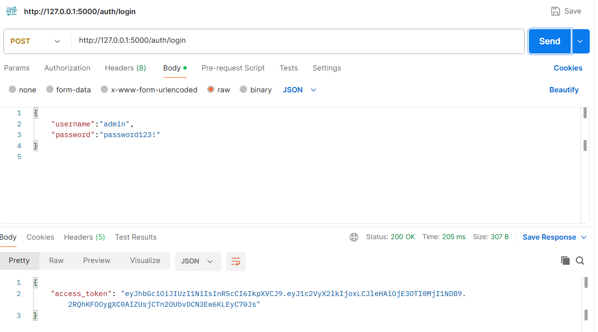

# Secure REST API Lab Project
This project implements a secure REST API based on Python Flask. It provides JWT‑based user authentication, access control for protected endpoints, and security countermeasures against SQL Injection and XSS. GitHub Actions CI/CD pipeline is configured to run automated security scanning with Bandit (SAST) and Safety (SCA).

## Environment & Dependencies
- Python 3.8
- Packages: Flask, Flask‑SQLAlchemy, bcrypt, pyjwt, python‑dotenv
- Database: SQLite
- Testing tool: Postman

## API Endpoints
| Method | Endpoint | Description | Require JWT Token |
|--------|----------|-------------|-------------------|
| POST | `/auth/login` | User login, returns JWT access token | No |
| GET | `/api/data` | Return protected business data | Yes |
| GET | `/api/user/profile` | Get profile information of current logged‑in user | Yes |

1. `POST /auth/login`
- Accept username and password in JSON request body.
- Verify hashed user credentials and return a JWT token upon successful authentication.

2. `GET /api/data`
- Require request header: `Authorization: Bearer <token>`
- Reject requests without valid token and return 401 Unauthorized.

3. `GET /api/user/profile`
- Custom endpoint to fetch current user ID and username.
- Valid JWT token is mandatory for access.

> Test account: username `admin`, password `password123!`

## Postman Test Procedures
1. Start application: `python app.py`, service address: `http://127.0.0.1:5000`

### ① Login and obtain JWT token
- Method: `POST`
- URL: `http://127.0.0.1:5000/auth/login`
- Body → raw → JSON
```json
{
    "username":"admin",
    "password":"password123!"
}



### ② Access protected endpoint `/api/data`
- Method: `GET`
- URL: `http://127.0.0.1:5000/api/data`


### ③ Access protected endpoint `/api/user/profile`

- Method: `GET`
- URL: `http://127.0.0.1:5000/api/user/profile`


## Security Mechanism Implementation

1. **Password Hashing**
User passwords are stored as bcrypt hashes in SQLite instead of plaintext. The server never stores raw passwords.
2. **JWT Authentication & Authorization**
Stateless token-based authentication. Protected endpoints validate the signature and expiration of JWT before serving requests.
3. **SQL Injection Mitigation**
Use Flask-SQLAlchemy ORM parameterized queries. User inputs are not directly concatenated into raw SQL strings.
4. **XSS Mitigation**
API returns JSON data without rendering raw user input into HTML; special characters are escaped if consumed by frontend.
5. **CI/CD Security Scan**
GitHub Actions workflow runs two security checks for every commit and pull request:

- Bandit: Static Application Security Testing (SAST) to find insecure Python code patterns.
- Safety: Software Composition Analysis (SCA) to detect vulnerable dependencies.

## GitHub Actions CI Workflow Overview

File path: `.github/workflows/security-scan.yml`

- Trigger: `push` and `pull_request`
- Job steps:
  1. Checkout source code
  2. Set up Python environment
  3. Install dependencies
  4. Run Bandit SAST scan
  5. Run Safety SCA dependency scan
- Scan reports will be shown in workflow logs. If high-risk vulnerabilities are found, the pipeline fails.
